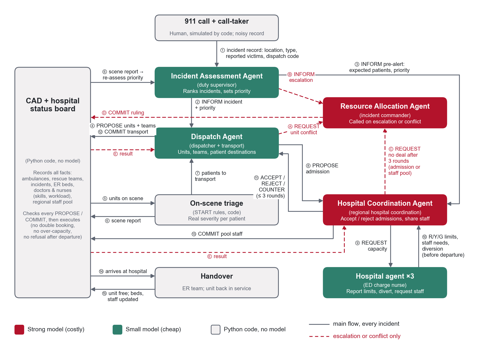
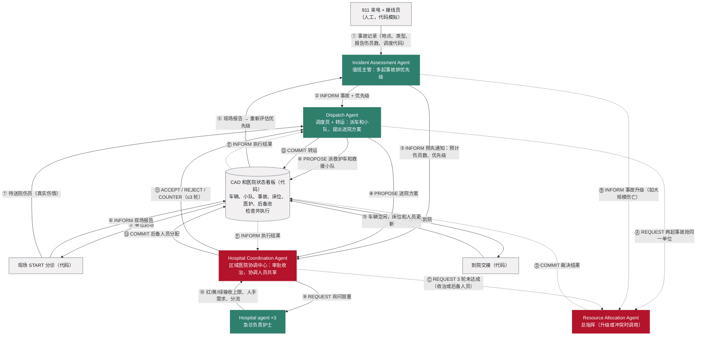
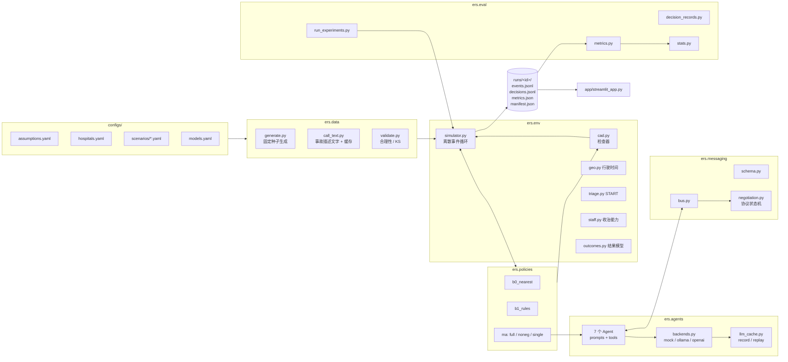
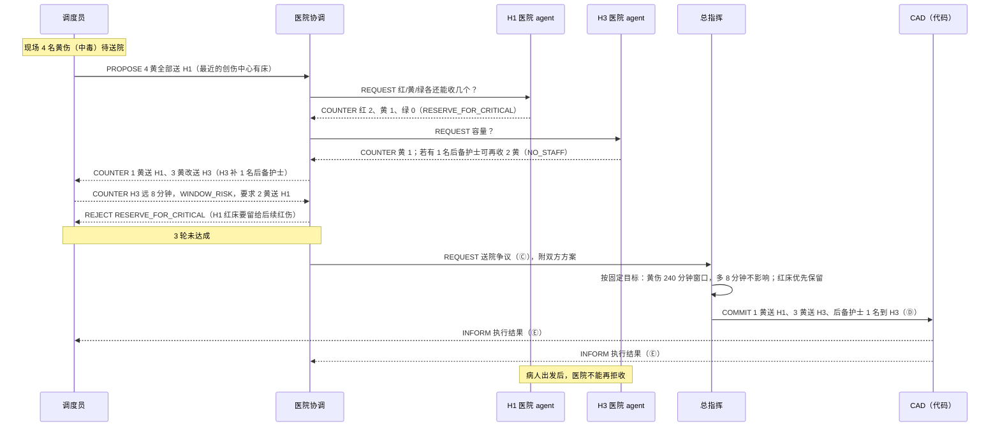
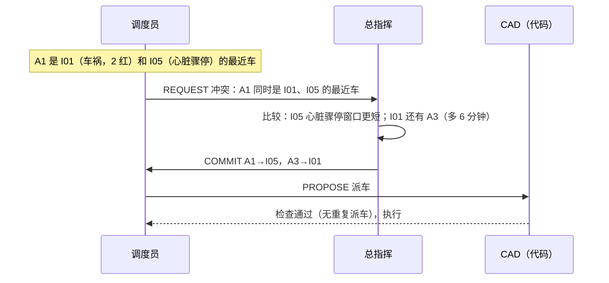
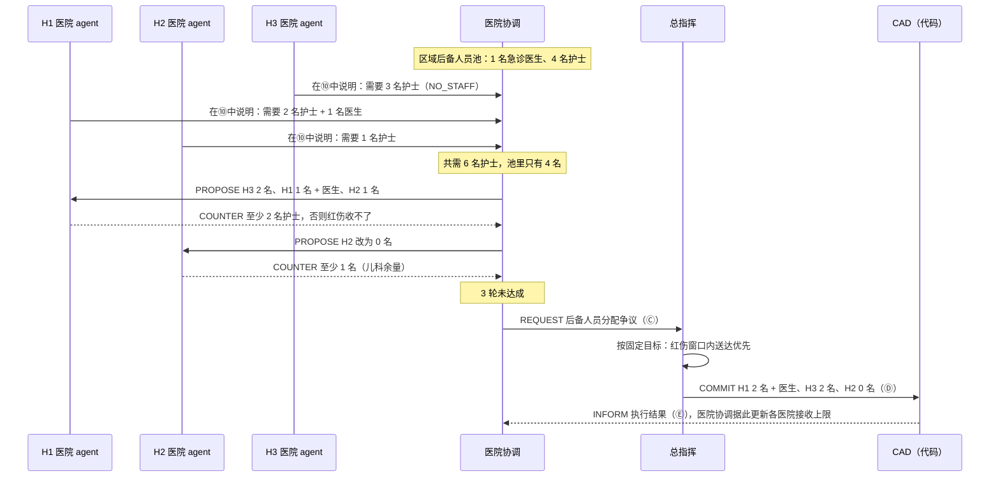
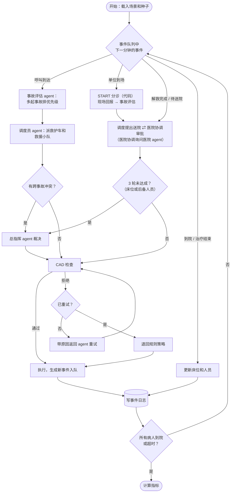

# 多 Agent 应急协调模拟：完整计划

这份文档整理了项目的设计和完整计划。所有设计都以作业要求为准：第 1 节逐条对照作业要求，后面各节是具体做法。标了"假设"的数值都可以调整，会在实验开始前固定下来，并写进假设文档（`docs/assumptions.md`）。

项目按 **MVP → 后期** 两步推进（见第 11 节）。MVP 已经满足作业的全部硬性要求；后期只是加深和扩大，不推翻 MVP 的结构。文中用 **【MVP】** 和 **【后期】** 标出每项功能属于哪一步，没有标的表示两步都适用。

---

## 1. 作业要求对照表

| 作业要求 | 我们的做法 | 在哪一节 |
|---|---|---|
| 使用 OpenAI Agents SDK for Python | 所有 agent 都用 Agents SDK 的 `Agent` 编写，结构化输出用 Pydantic；模型后端可切换（本地 Ollama / OpenAI） | 3.3、7 |
| 至少 4 个职责不同的 agent，各有目标、工具和决策规则 | 作业要求的 4 个 agent 都有，另加 3 个医院层 agent；每个 agent 的目标故意设计成互相冲突 | 3 |
| Incident Assessment Agent：评估事故、估计紧急程度、把优先级告诉其他 agent | 事故评估 agent（值班主管）：读取接线员（人工，代码模拟）录入的结构化事故记录，在所有正在进行的事故之间评估紧急程度、排出优先级，通知调度员；同时向医院协调预先通知预计伤员数和优先级；收到现场报告后重新评估，事故升级时通知总指挥 | 2、3、4 |
| Dispatch Agent：协调救护车和救援小队，评估相互竞争的事故，按紧急程度、位置和可用性提出分配方案 | 调度员 agent（兼任现场转运职能）：通过 CAD 查看单位状态，派出最近的合适救护车和救援小队；伤员分诊后，为每个伤员提出送院方案，目标是尽快送走 | 3 |
| Hospital Coordination Agent：追踪急诊容量、人手和治疗能力，接受或拒绝收治，协商资源共享 | 医院协调 agent（对应区域医院协调中心）：通过医院状态看板追踪三家医院的急诊容量、医护人员和治疗能力，向医院 agent 询问接收上限，对调度提出的每个送院方案**接受、拒绝或改派**；在医院之间协商区域后备人员池的分配（资源共享）。另有 3 个医院 agent（急诊负责护士）报出本院红、黄、绿接收上限、申请分流（仅限出发前）、申请人手 | 3、6 |
| Resource Allocation Agent：协调调度和医院之间的冲突需求 | 总指挥 agent：调度和医院协调就送院谈不拢时裁决；跨事故抢同一辆车或同一支小队时裁决；后备人员池分配争议时裁决；事故升级时重新分配资源；【后期】审批外地支援 | 3、6 |
| 结构化消息，包含发送者、接收者、消息类型、事故编号、建议动作 | 消息格式固定包含这 5 个字段，另加消息编号、模拟时间、回复对象、轮次、原因代码和结构化内容 | 6 |
| 无法满足所有请求时要协商替代方案 | 固定的消息类型和协商规则，最多 3 轮，之后由总指挥裁决 | 6 |
| 环境包含事故、医院、救护车、医护、救援小队、调度资源 | 全部包含，属性见第 4 节；医护（技能、在岗、工作量上限）和收治能力挂钩；有区域后备人员池；救援小队负责解救 | 4 |
| 规模可参考 3 家医院、5 辆救护车、10 到 15 起事故、有限的医护人员池 | 3 家医院、默认 6 辆救护车（5 辆时一起大事故就会让背景呼叫等 1 小时以上，见假设文档的校准记录）、3 支救援小队、一个区域后备人员池，每个场景 10 到 15 起事故 | 4、5 |
| 用 LLM 或类似的库生成合成数据，写明假设，保证可复现 | 数字由 Python 加固定种子生成，事故描述文字由 LLM 生成一次后缓存；LLM 决策也缓存并可重放；有假设文档和数据说明卡 | 4、7、10 |
| 证明通信、协调、协商带来可衡量的改善 | 和两个基线以及"去掉协商"的消融组在同样的种子上做成对比较，报告置信区间和显著性 | 8 |
| 可视化：事故地图、资源面板、agent 活动面板、分配与协商历史、性能指标；展示系统随事故到来和 agent 决策而变化 | Streamlit 加 Plotly，包含这 5 个部分；时间滑块回放【MVP】，播放动画和实时模式【后期】 | 9 |

---

## 2. 真实流程的依据

流程和规则参考的是美国的公开资料：

| 环节 | 现实中的做法 | 参考来源 |
|---|---|---|
| 接线 | 接线员（经过急救医疗调度 EMD 培训）按标准化问题询问，得出调度代码，代码的紧急程度分 Ω、A、B、C、D、E 六级：E 为危及生命、需要立即复苏（如心脏骤停），D、C 需要高级生命支持并鸣笛出警，B、A 通常基础生命支持即可，Ω 可能不需要派救护车。代码写入 CAD；接线员同时在电话里给出到场前指导。接线和调度代码都由人按协议完成，不由 AI 判断。本项目里接线员是人工岗位，用代码模拟 | IAED 关于调度代码的说明，Maine EMS 和 Loudoun County 的急救调度指南 |
| 接线和调度的分工 | 接线员负责和报警人沟通；调度员负责和现场单位沟通、派出最近的合适单位、掌握所有单位的状态。很多调度中心由同一个人兼任两个岗位 | NAEMSP 关于 EMS 调度的资料，EMRA 关于调度的文章 |
| 派车 | CAD 结合车辆定位（AVL），派按时间算最近的合适车辆；调度代码决定派高级还是基础生命支持车辆、是否鸣笛 | 同上 |
| 现场回报 | 首个到场单位向调度中心报告现场情况（size-up），之后持续更新；调度中心据此更新事故记录，并按现场要求增派资源 | EMS1 关于现场评估的文章 |
| 现场 | 大型事故按事故指挥体系运作，设总指挥，下设分诊、治疗、转运负责人 | Wisconsin EMS MCI 规划指南，Northern Kentucky MCI 计划 |
| 送院 | 转运负责人为每个病人指定医院，并联系区域医院协调中心，避免把病人全压到一家医院 | Wisconsin 指南，JEMS 关于转运组的文章 |
| 送院原则 | 最重的伤员送当地范围内等级最高的创伤中心；中度风险送创伤中心即可；儿童优先送有儿科能力的医院；单纯烧伤送烧伤中心 | 美国外科医师学会 2021 年 Field Triage Guidelines |
| 医院状态 | 医院在 EMResource 等平台上报床位和分流状态；可因设备、人手申请暂时创伤分流；因急诊拥挤而分流的，在大规模伤亡事件中必须重新开放 | Juvare EMResource 介绍，Sacramento County 分流政策 |

各县的具体细节会有差别，我们取的是通行做法。

### 2.1 和现实相比的简化（汇报时说明）

| 现实中的做法 | 本项目的做法 | 为什么这样简化 |
|---|---|---|
| 一旦确认是大规模伤亡事件，第一辆到场的车就建立事故指挥，总指挥从一开始就在 | 总指挥 agent 只在升级上报（Ⓑ）或出现冲突（Ⓐ、Ⓒ）时调用 | 节省模型调用次数；没有冲突时总指挥本来也不需要做决定 |
| 医院不会对单个病人讨价还价。协调方先问各家医院"红、黄、绿各还能收几个"，医院报数后再按数分配；病人已到急诊门口，医院不能拒收 | ⑨ 是医院协调询问容量，⑩ 是医院报出各级接收上限；医院的"拒绝"只能在病人出发前以申请分流的形式出现，出发后不能拒收（CAD 检查这条规则） | 和现实做法一致，只是把容量询问放进了消息协议 |
| 突发事件中医院之间临时借护士并不常见。医院通常召回自己休班的员工；跨医院支援多出现在持续时间较长的灾害中，由区域医疗联盟协调 | 设一个**区域后备人员池**（有限的医生和护士），三家医院向医院协调 Agent 申请，在池子不够时互相争；谈不拢由总指挥裁决 | 作业要求"几家医院争夺有限的医护人员"和"a limited pool of medical staff"；后备池既满足这一点，也比"医院之间互借"更接近现实。【后期】可加"召回本院休班员工" |
| 现场的转运负责人决定每个伤员送哪家医院，并联系区域医院协调中心确认，避免把病人全压到一家医院 | 调度 Agent 兼任转运职能，提出送院方案；医院协调 Agent 扮演区域医院协调中心，接受、拒绝或改派 | 作业要求调度"提出分配方案"、医院协调"接受或拒绝收治"；把现场转运职能并入调度，可以少一个 agent，也让作业例子中"调度要马上送人、医院想保留床位"的冲突直接出现 |
| CAD 只管车辆和事故；医院床位和分流状态记录在 EMResource 这类医院状态平台上 | 两者合成一个代码模块"CAD 和医院状态看板"（下文简称 CAD），并加上检查规则 | 模拟里只需要一个统一的事实来源，方便检查和记录 |

---

## 3. 系统架构和角色

### 3.1 工作流程



*图 1　按真实急救流程设计的系统工作流程（图源：`docs/assets/draw_workflow.py`）*

图中每条线都有方向：箭头表示信息从谁流向谁，线上的编号和文字说明传的是什么（消息类型见 6.2）。实线是每起事故都会走的主流程，虚线只在升级上报或发生冲突时出现。"CAD 和医院状态看板"（简称 CAD）画在最左边、贯穿上下，因为所有提议（PROPOSE）和最终决定（COMMIT）都要先经过它检查才执行。图 1 有中文版：`docs/assets/workflow_zh.png`。下面的图 2 是同一张图的 Mermaid 文本版本，方便在仓库里直接修改。



*图 2　参与者之间的消息流向（Mermaid 版）*

图例：红色为 `strong` 档模型（判断最难的角色），绿色为 `fast` 档模型（调用频繁、规则清楚的角色），灰色为 Python 代码，不用模型。

**主流程（实线，每起事故都会走）**

| 步骤 | 从 → 到 | 内容 |
|---|---|---|
| ① | 接线员 → 事故评估 | 结构化事故记录：地点、类型、报告的伤员数和伤情、调度代码。电话里的信息有误差，真实伤情要等现场分诊 |
| ② | 事故评估 → 调度员 | 事故信息和优先级（多起事故之间谁先谁后） |
| ③ | 事故评估 → 医院协调 | 预先通知：预计伤员数和优先级，让医院方提前准备 |
| ④ | 调度员 → CAD | 提议派哪辆救护车、哪支救援小队；CAD 检查后执行 |
| ⑤ | CAD → 现场分诊 | 首个单位到场，触发 START 分诊 |
| ⑥ | 现场分诊 → CAD → 事故评估 | 现场报告（伤员数、分诊结果）先进入 CAD，事故评估据此重新评估优先级 |
| ⑦ | 现场分诊 → 调度员 | 待送院的伤员和真实伤情 |
| ⑧ | 调度员 → 医院协调 | 为每个伤员提出送院方案（调度的目标是尽快送走，倾向于最近的医院） |
| ⑨ | 医院协调 → 医院 agent | 询问"红、黄、绿各还能收几个" |
| ⑩ | 医院 agent → 医院协调 | 报出各级接收上限（医院想为危重病人保留余量）；缺人时说明需要多少后备人员；必要时申请分流（只能在病人出发前） |
| ⑪ | 医院协调 → 调度员 | 对每个送院方案接受、拒绝（带原因）或改派（给出替代医院）；⑧–⑪ 最多来回 3 轮 |
| ⑫ | 调度员 → CAD | 双方同意后的转运决定；CAD 检查后执行。病人出发后，医院不能再拒收 |
| ⑬ | 医院协调 → CAD | 后备人员池的分配；CAD 检查后执行 |
| ⑭ | CAD → 到院交接 | 救护车到院 |
| ⑮ | 到院交接 → CAD | 车辆恢复空闲，可以再派；床位和人员更新 |

**升级和冲突处理（虚线，只在需要时出现）**

总指挥不在主流程上，只在升级上报或发生冲突时被调用（现实中的差别见 2.1）。**它的下一步永远是把裁决交给 CAD（Ⓓ），CAD 执行后再把结果通知调度员和医院协调（Ⓔ）**，主流程从断开的地方继续。

| 触发 | 总指挥收到 | 总指挥做什么 | 下一步 |
|---|---|---|---|
| 两起事故抢同一辆车或同一支小队 | Ⓐ 调度员的请求 | 决定这个单位给谁，另一起事故派哪个 | Ⓓ 交给 CAD 执行 → Ⓔ 通知调度员 → 回到 ④ 之后 |
| 事故升级（如大规模伤亡） | Ⓑ 事故评估的通知 | 重新分配跨事故的车辆和小队 | Ⓓ 交给 CAD 执行 → Ⓔ 通知调度员和医院协调 |
| 调度和医院方就送院谈不拢，或后备人员池分配谈不拢 | Ⓒ 医院协调的请求（附上调度的送院方案和各医院的接收上限） | 按固定目标裁决：送哪家医院、后备人员给哪家 | Ⓓ 交给 CAD 执行 → Ⓔ 通知调度员和医院协调 → 回到 ⑫、⑬ 之后 |

医院缺人**不直接找总指挥**：医院先在 ⑩ 里告诉医院协调，由医院协调在医院之间协商后备人员池；协商不成才经 Ⓒ 交给总指挥。

### 3.2 角色

| Agent（职位） | 对应作业要求 | 负责什么 | 自己的目标（故意互相冲突） | 工具示例 | 模型档 |
|---|---|---|---|---|---|
| Incident Assessment Agent（值班主管） | Incident Assessment Agent | 读取结构化事故记录，在所有正在进行的事故之间评估紧急程度、排优先级；通知调度员，并向医院协调预先通知；收到现场报告后重新评估（例如升级为大规模伤亡事件） | 不漏判危重事故，危重事故先得到资源 | `active_incidents`、`score_incident` | fast：输入是结构化数据，判断难度不高；调用次数少 |
| Dispatch Agent（调度员，兼任转运） | Dispatch Agent | 派救护车和救援小队，处理多个事故抢同一单位的情况；伤员分诊后为每个伤员提出送院方案 | 每起事故尽快有车和小队到场，伤员尽快送走 | `candidate_units`（最近 3 个，含到达时间）、`travel_time` | fast |
| Hospital Coordination Agent（区域医院协调中心） | Hospital Coordination Agent | 追踪三家医院的急诊容量、医护人员和治疗能力；向医院询问接收上限；对每个送院方案接受、拒绝或改派；在医院之间协商区域后备人员池 | 每个病人去能力匹配、有容量的医院，各医院负荷均衡 | `hospital_board`、`capability_matrix`、`staff_pool` | strong：这是最想观察的决策 |
| Hospital agent ×3（急诊负责护士） | Hospital Coordination Agent 的下属（医院层） | 按红、黄、绿报出本院接收上限；必要时申请分流（只能在病人出发前）；缺人时向医院协调申请后备人员 | 为后续危重病人保留余量，不超负荷 | `my_capacity`、`my_staff` | fast |
| Resource Allocation Agent（总指挥） | Resource Allocation Agent | 裁决调度和医院方谈不拢的送院方案；跨事故的车辆和小队取舍；裁决后备人员池的分配争议；事故升级时重新分配；【后期】审批外地支援 | 全局：危重伤员窗口内送达优先，其次响应时间 | `conflict_summary` | strong：升级上报或有冲突时调用 |
| CAD 和医院状态看板、START 规则、行驶时间 | 环境和检查（代码） | 记录所有事实（救护车、救援小队、事故、急诊床位、医生和护士、后备人员池），阻止重复派车、超床位、超人员工作量、出发后拒收等违规 | — | 无 | 不用模型 |

### 3.3 用 OpenAI Agents SDK 实现的方式

- **总调度在 Python 里。** 离散事件模拟器按模拟时间推进，遇到需要决策的事件，才调用相应的 agent（`Runner.run`）。agent 之间不直接对话，消息都经过 Python 的消息总线，这样每条消息都能记录、校验和回放。
- **每个 agent 是一个 SDK 的 `Agent`。** `instructions` 用统一的 prompt 模板（7.1）；`output_type` 是 Pydantic 模型，输出就是第 6 节的结构化消息；`tools` 是 `function_tool`，只能读取环境状态，不能修改。
- **agent 只提议，代码执行。** agent 输出的 PROPOSE、ACCEPT、COMMIT 等消息，交给 CAD 检查器（`cad.py`）检查，通过后才改变环境状态。LLM 永远拿不到可写的状态对象。
- **主流程不用 handoff。** SDK 的 handoff 是把对话控制权交给另一个 agent，适合客服式的串行对话；我们的场景是多起事故并发、事件驱动的协商，用消息总线更合适，也更容易记录。
- **追踪。** SDK 自带的 tracing 关掉上传，改用自定义 `TraceProcessor` 把每次调用的输入、输出、token 写进事件日志。

### 3.4 代码模块架构



三种决策方式（B0、B1、MA）实现同一个 `Policy` 接口，跑在同一个模拟器上，所以对比是公平的。

---

## 4. 数据和环境

### 4.1 真实数据只用来校准规律，不照搬记录

- **旧金山消防和急救出警记录：** 提取三类规律。一是时间，包括接警、派车、到场、送医、车辆重新空出各要多久。二是地点，出警集中在哪些热点。三是规模，大多数事故很小，少数很大。这份数据已经核实过字段。
  - 【MVP】先按公开资料手工设定分布形状和参数，写进 `assumptions.yaml`。
  - 【后期】经 SODA API 下载一年的子集，自动拟合参数，汇总成 `data/calibration/sf_params.json` 入库（原始数据不入库）。
- **加州医院床位文件：** 提供医院床位规模，可以关联带坐标的位置文件。【后期】用来校准三家医院的床位规模。
- **数据里没有的内容，作为假设：** 每起事故的伤员数、每个伤员的伤情、具体病情种类的比例、医护人数、救治时间窗口、高峰放大系数。

### 4.2 地图

- 用**示意性的 2D 网格**，约 30 × 30 km，不用真实地理坐标。
- 地图分成若干区，每区有拥堵系数；有一座桥连接 H1 所在的区域（对应"要过桥"）。
- 三家医院、车站位置固定；事故位置按热点分布抽样（热点形状参照旧金山规律）。
- 部分场景有封路，用"某条边不可通行或系数变大"表示。

### 4.3 三家医院的档案

| 医院 | 定位 | 专长 | 平时到市中心 | 常见短板 |
|---|---|---|---|---|
| H1 | 一级创伤中心 | 骨科、神经外科、烧伤科、卒中中心 | 约 20 分钟，要过桥 | 床位紧张 |
| H2 | 儿童医院 | 儿科创伤、儿科重症 | 约 12 分钟 | 成人床位很少 |
| H3 | 社区医院 | 普通急诊、内科、心导管室 | 约 6 分钟，最近 | 常缺护士，没有创伤资质 |

距离和短板都是假设，每个场景会调整医院状态。

**能力矩阵**（2 = 能力匹配，1 = 可以接收但不是最佳，例如社区医院先稳定再转院，0 = 不能接收）：

| 伤情类别 | H1 创伤中心 | H2 儿童医院 | H3 社区医院 |
|---|---|---|---|
| 成人创伤 | 2 | 0 | 1 |
| 儿童创伤 | 1 | 2 | 1 |
| 成人烧伤 | 2 | 0 | 0 |
| 儿童烧伤 | 2 | 1 | 0 |
| 卒中 | 2 | 0 | 1 |
| 心脏（心梗、心脏骤停复苏后） | 1 | 0 | 2 |
| 成人内科、中毒 | 2 | 0 | 2 |
| 儿童内科、中毒 | 1 | 2 | 1 |

这张表用于"能力匹配率"指标、B1 规则参考和医院协调 Agent 的工具输出。数值放在 `configs/hospitals.yaml`。

### 4.4 其他实体

| 实体 | 属性 | 来源 |
|---|---|---|
| 事故 | 时间、位置、类型、伤员数、每个伤员的伤情和体征、时间紧迫度、需要的技能（是否需要解救）；接线员录入的报告值（伤员数、伤情，带误差）和调度代码；事故描述文字 | 时间和地点按旧金山规律抽样；伤员和体征按场景设定；报告值在真实值上加误差；调度代码按协议规则算出；描述文字由 LLM 生成一次并缓存，只用于展示 |
| 救护车 | 位置、载量（每车 2 个载量单位：红伤独占一车，2 名黄伤，或最多 3 名坐姿绿伤）、高级或基础生命支持、状态 | 默认 6 辆；测试 4、6、8 辆三档【后期】 |
| 救援小队 | 位置、技能（救援、消防、危化品）、状态 | 默认 3 支 |
| 医护人员 | 技能（创伤外科、急诊、儿科、ICU 护士等）、在岗情况、工作量上限 | 假设 |
| 区域后备人员池 | 医生和护士的数量与技能、到岗延迟 | 假设；三家医院共用、互相争 |
| 交通 | 地图分区，每区有拥堵系数，部分场景有封路 | 假设，固定种子 |

**医护人员和收治的关系**：

- 每家医院的**有效收治能力 = min(空床, 医生余量, 护士余量)**，按伤情分别计算。
- 红伤：占 1 张床 + 1 名对口医生（创伤外科、儿科、烧伤等）+ 护士比 1:2。
- 黄伤：占 1 张床 + 急诊医生工作量 1/4 + 护士比 1:4。
- 绿伤：占急诊快速通道，不占床，护士比 1:6。
- 每类伤员占用急诊的时长（假设：红 60 分钟、黄 45 分钟、绿 20 分钟，按大规模伤亡事件的应急预案快速转出急诊），结束后释放床位和人员。
- **区域后备人员池**：区域里有一个有限的后备人员池（假设 1 名急诊医生、4 名护士），三家医院缺人时向医院协调 Agent 申请，池子不够时互相争。【MVP】分到的人员在固定延迟（假设 30 分钟）后到岗，到场景结束前不归还。【后期】加入"召回本院休班员工"、人员轮换和归还。

### 4.5 救援小队和现场分诊

- 事故类型决定是否需要解救：被困（车祸夹困、楼房倒塌）需要"救援"技能，火灾需要"消防"，危化品需要"危化品"技能【后期细分】。
- 需要解救的伤员，要等对应小队到场并完成解救（有解救时长，假设 10 到 30 分钟），才能被转运。
- **首个到场的单位**（救护车或救援小队）触发 START 分诊（代码），得到每个伤员的真实伤情。首个到场单位向调度中心回报现场情况（伤员数和分诊结果），Incident Assessment Agent 据此重新评估事故优先级，事故升级时通知总指挥；分诊结果同时交给调度员，由调度员为每个伤员提出送院方案。

### 4.6 环境规则

- **行驶时间：** 行驶时间等于距离除以速度，再乘以拥堵系数。所有决策方式都用同一个函数（`geo.py`）。
- **模拟时钟：** 离散事件模拟，粒度 1 分钟。时钟是模拟的，LLM 调用快慢不影响模拟时间，决策本身不消耗模拟时间。
- **事件类型：** 呼叫到达、单位到场、解救完成、分诊完成、离开现场、到院、交接完成、治疗结束、医院状态变化（例如中途故障【后期】）。
- **批量决策：** 同一分钟里同类的待决策项一起交给 agent，例如同一起事故中所有待送院的病人一次决定，减少调用次数。
- **伤情判断分两次：**
  - 电话阶段：接线员（人工，代码模拟）按协议录入结构化记录和调度代码，报告的伤员数和伤情带误差（假设见 assumptions）。事故评估 Agent 根据这些记录在多起事故之间排优先级。准确程度用"事故评估的优先级和现场真实伤情的一致率"衡量（8.2）。
  - 到现场后，用 START 规则根据体征算出红、黄、绿、黑，这是真实伤情，也是打分用的标准答案。

### 4.7 结果模型

每个伤情等级有一个救治时间窗口，在窗口内送到**能力匹配**的医院才算"救到"。默认值（假设，实验前冻结）：

| 伤情 | 窗口（从呼叫到到院） | 未处理时的变化 |
|---|---|---|
| 红 | 60 分钟 | — |
| 黄 | 240 分钟 | 超过 90 分钟仍未离开现场，恶化为红，窗口按红重新计算 |
| 绿 | 无窗口，到院即算救到 | — |
| 黑 | 不计入"救到"，也不计入"未处理" | — |

"未处理的危重事故" = 含红伤、且红伤没有全部在窗口内送到能力匹配医院的事故。

【后期】更细的恶化模型（例如按伤情类别不同的生存概率曲线）。

### 4.8 数据检验

- 【后期】合成数据的响应时间、地点和事故规模，与旧金山真实数据对比，用 KS 检验判断分布是否相似。
- 【MVP】合理性检查：床位不能为负，每起事故至少有一个伤员，编号唯一，伤员数与伤情明细一致。
- 【MVP】事故描述文字必须和报告值一致：生成后从文字里抽取伤员数和地点，与报告值比对，不一致的重新生成。

---

## 5. 场景库

### 5.1 所有场景通用的规则

- **组成：** 每个场景由主要事故加背景呼叫组成，共 10 到 15 起事故，呼叫在 120 分钟内到达（之后继续推进到所有病人到院，最长 420 分钟）。
- **背景呼叫：** 时间和地点按旧金山规律抽样，具体病情种类按设定比例，比如心脏骤停、中风、胸痛、摔倒、呼吸困难。
- **资源：** 默认 6 辆救护车、3 支救援小队，另测 4 辆和 8 辆两档【后期】。总指挥可以申请外地支援车辆，但要等一段时间才到（假设约 20 分钟）【后期】。

### 5.2 八个场景

| 场景 | 主要事故 | 背景呼叫 | 总数 | 医院处境 | 交通 | 考验什么 | 阶段 |
|---|---|---|---|---|---|---|---|
| 1 高速连环车祸 | 8 名成人，2 红 3 黄 3 绿 | 11 起，含心脏骤停、中风 | 12 | 正常 | 晚高峰，去 H1 要 35 分钟 | 能力和距离的取舍；车祸和心脏骤停抢车 | 【MVP】 |
| 2 校车事故 | 14 名儿童加 1 名司机 | 10 起，含儿童哮喘 | 11 | H2 只剩 4 张床 | 正常 | 儿童优先送儿科；儿科满了怎么分 | 【后期】 |
| 3 聚餐食物中毒 | 20 人，3 红 7 黄 10 绿 | 12 起，含 2 起疑似心梗 | 13 | H3 缺 2 名护士 | 正常 | 大量轻症怎么分散；不占用创伤床位；三家医院争后备人员 | 【MVP】 |
| 4 高楼火灾 | 9 人烧伤加吸入烟雾，含 3 名儿童、1 名烧伤加坠落伤 | 10 起 | 11 | H1 烧伤床只剩 2 张 | 火场周围封路 | 烧伤、外伤、儿童分别送哪；绕路 | 【后期】 |
| 5 两起大事故同时发生 | 车祸 8 人，加食物中毒 20 人 | 10 起 | 12 | 正常 | 晚高峰 | 总指挥在两起事故之间分配车辆；是否申请支援 | 【MVP】 |
| 6 医院中途故障 | 车祸；第 30 分钟 H1 的 CT 故障，申请创伤分流 | 12 起，含中风 | 13 | 先正常，后 H1 分流 | 正常 | 路上的病人改送；中风病人怎么办 | 【后期】 |
| 7 夜班人手危机 | 夜间公交侧翻，12 名成人 | 10 起 | 11 | H3 有床没护士，H1 有护士没床 | 夜间畅通 | 争后备人员池；谈不拢时总指挥裁决 | 【后期】 |
| 8 地震 | 3 起：楼房倒塌 12 人、桥上事故 6 人、养老院 8 人 | 12 起，多为轻伤 | 15 | 三家都接近满负荷 | 大桥封闭，H1 基本到不了 | 全系统资源不足时先救谁 | 【后期】 |

规模和资源经过校准（见假设文档的校准记录）：食物中毒原定 30 人，但 6 辆车在没有外地支援时无法处理，MVP 改为 20 人。

MVP 选 1、3、5 三个场景，因为它们正好覆盖作业里的三类冲突（见 5.3），而且不依赖封路、医院中途故障、外地支援这些后期才做的环境功能。场景 5 在 MVP 里不申请外地支援，总指挥只在现有车辆中分配。

### 5.3 场景和作业里三个冲突例子的对应

| 作业中的冲突例子 | 对应场景 | MVP 覆盖 |
|---|---|---|
| 医院想保留床位，调度想马上送人 | 2、3、4 | 3 |
| 两起事故抢同一辆救护车 | 1、5、8 | 1、5 |
| 几家医院争夺有限的医护人员 | 3、7 | 3 |

---

## 6. 消息和协商

### 6.1 消息格式

作业要求的 5 个字段（sender、recipient、message_type、incident_id、proposed_action）都包含，另外加了消息编号、模拟时间、回复对象、轮次、原因代码和结构化内容：

```json
{
  "message_id": "M0142",
  "sim_time": 23,
  "sender": "Dispatch",
  "recipient": "HospitalCoordination",
  "message_type": "PROPOSE",
  "incident_id": "I01",
  "proposed_action": "transport P04 (red, pelvic fracture) to H3, ETA 7 min",
  "payload": {"action": "admit", "patient_id": "P04", "hospital_id": "H3", "eta_min": 7},
  "in_reply_to": null,
  "round": 1,
  "reason_code": "WINDOW_RISK"
}
```

- `proposed_action` 是给人看的一句话；`payload` 是给代码检查和执行用的结构化内容。
- `in_reply_to` 把同一次协商的消息串成一条线程，可视化里按线程展示。

### 6.2 消息类型

REQUEST、PROPOSE、ACCEPT、REJECT、COUNTER、COMMIT、INFORM。

| 类型 | 含义 | 例子 |
|---|---|---|
| REQUEST | 请求对方给出信息、方案或资源 | 医院协调询问 H1"红、黄、绿各还能收几个" |
| PROPOSE | 提出具体方案 | 调度提出：P04 送 H3（最近）；医院协调提议：后备池 2 名护士给 H3、1 名给 H1 |
| ACCEPT | 接受方案 | 医院协调接受"P07 送 H3"；H3 接受后备人员分配 |
| REJECT | 拒绝，必须带原因代码。医院方对收治的拒绝只能在病人出发前；医院自身的拒收以申请分流（DIVERSION）的形式出现 | 医院协调拒绝"P04 送 H3"：CAPABILITY_MISSING；H1 申请创伤分流：DIVERSION（CT 故障） |
| COUNTER | 还价，必须是具体的替代方案 | 医院协调改派："P04 改送 H1"；H1 报出接收上限：红 2、黄 1、绿 0（RESERVE_FOR_CRITICAL） |
| COMMIT | 最终确定，交给 CAD 执行 | 调度的转运决定、医院协调的后备人员分配、总指挥的裁决 |
| INFORM | 通知，不需要回复 | 事故评估的预先通知、医院更新容量、现场报告、执行结果 |

### 6.3 原因代码

| 代码 | 含义 |
|---|---|
| NO_BED | 没有合适的空床 |
| NO_STAFF | 有床但人手不够 |
| CAPABILITY_REQUIRED | 伤情需要特定能力（创伤、儿科、烧伤等） |
| CAPABILITY_MISSING | 本院没有这项能力 |
| DIVERSION | 医院处于分流状态 |
| RESERVE_FOR_CRITICAL | 为可能到来的危重病人保留余量 |
| CLOSER_ALTERNATIVE | 有更近且合适的选择 |
| HIGHER_PRIORITY | 资源要先给更紧急的事故 |
| UNIT_BUSY | 单位已被占用 |
| WINDOW_RISK | 再等会超出救治窗口 |
| STAFF_POOL | 区域后备人员池的申请和分配 |

### 6.4 协商规则

- 拒绝时必须给出原因代码，还价必须是具体的替代方案。
- 医院按红、黄、绿报接收上限，不对单个病人讨价还价；病人出发后，医院不能拒收。
- 协商最多 3 轮，之后由总指挥按一个固定目标裁决：先看危重伤员是否在窗口内送到合适医院，再看响应时间。
- 总指挥的方案也要再经过代码检查。
- 所有消息都写进事件日志，供可视化和评估使用。

### 6.5 三类冲突的协商时序

**冲突一：医院想保留床位，调度想马上送人（场景 3）**



**冲突二：两起事故抢同一辆救护车（场景 1、5）**



**冲突三：几家医院争夺有限的医护人员（场景 3，后期场景 7）**



### 6.6 总指挥何时出场

总指挥只在升级上报或发生冲突时被调用（和现实的差别见 2.1），触发条件：

1. 同一辆车或同一支救援小队同时是两起以上事故的最优选择（Ⓐ）；或者一起紧急事故（E、D 级或有红伤）一辆车都没有、也没有空闲车时，调度员请求总指挥把别处"空等"的车改派过来。空等指车上没有病人，并且是多派的车：一起事故保留和它还需要的趟数一样多的空车（离现场最近的几辆），只有多出来的才能被改派。正在现场等被困伤员解救的车不算空等，因为被困的往往是伤得最重的人，解救出来就要马上送走。改派只有完整 MA 有，MA-NoNeg 和基线都没有。
2. 事故评估根据现场报告把事故升级，例如确认为大规模伤亡事件（Ⓑ）。
3. 调度和医院协调就送院方案协商 3 轮仍未达成，或后备人员池分配在医院之间协商 3 轮仍未达成（Ⓒ）。
4. 【后期】需要申请外地支援车辆。

### 6.7 失败处理

1. agent 输出不是合法的结构化消息，或动作违反规则（重复派车、超床位、超人员工作量、送去不能接收的医院、病人出发后拒收、后备池超额分配）→ CAD 拒绝并返回原因。
2. agent 带着原因重试 1 次。
3. 仍然失败 → 退回规则策略（B1 的对应规则）完成这个决定。
4. 每次违规拦截和退回都记录，作为指标 `violations_blocked` 和 `fallback_rate`。

**角色规则检查（软检查）。** 上面是硬错误（格式不对、漏了决定、违反 CAD 规则）。另有一类是 agent 违反了自己提示词里的角色规则，但动作本身合法，例如医院协调在两家医院同样适合时改派到更远的那家，或者回答 ACCEPT 却填了另一家医院。对这类情况，代码把违反的规则写给 agent，让它重答 1 次；第二次的回答无论如何都采用，决定权仍在 agent，只记录次数（`rule_retries`、`rule_violations_kept`）。检查的规则有三处：医院协调的接受、改派、拒绝（提示词 `hospital_coordination.md` 的规则 1–3）；调度员对改派的回复（改派对红伤不更差就接受）；总指挥的送院裁决（先看适合程度，再看路程）。这些检查对 MA 和 MA-NoNeg 一样适用（后两处只在 MA 中出现）。

另外两条由代码直接保证：ACCEPT 一律表示接受调度提出的医院（填了别的医院时，MA 中按改派处理，MA-NoNeg 中按接受原方案处理）；改派到原方案同一家医院等于接受。

---

## 7. Prompt、模型后端和 token

### 7.1 Prompt 模板

每个 agent 的 prompt 都用同一个模板，分五栏：角色和目标、自己的优先级、能用的工具、明确的规则、固定的输出格式。

- 优先级故意设计成冲突的：调度想尽快把伤员送走（倾向最近的医院），医院想为后续危重病人保住床位，医院协调想让每个病人去能力匹配的医院、各医院负荷均衡。
- 数字一律通过工具查询，不让 AI 猜。
- 三家医院共用一个模板，只替换医院名称和数据。
- prompt 存在 `src/ers/agents/prompts/*.md`，带版本号，版本号写进每次运行的记录。

### 7.2 模型后端

模型后端可以切换，切换只改 `configs/models.yaml`，不改代码：

| 后端 | 用途 | 成本 | 阶段 |
|---|---|---|---|
| `mock` | 实现 SDK 的 `Model` 接口，内部用确定性规则策略产生结构化输出。用来验证整条管道、跑测试、做实时演示。**不代表 LLM 的结果** | 免费 | 【MVP】 |
| `ollama` | 开源模型 qwen2.5（3b、14b，支持工具调用），用 Ollama 运行，通过 SDK 的 `OpenAIChatCompletionsModel` 加 OpenAI 兼容地址接入。实验在学校 Explorer 集群的 GPU（Tesla V100 32 GB）上运行，MVP 报告里的 MA 结果用它 | 免费 | 【MVP】 |
| `openai` | OpenAI API。strong 档用贵模型，fast 档用便宜模型 | 按调用付费 | 【后期】 |

### 7.3 模型分配

| 档位 | 角色 | 理由 |
|---|---|---|
| strong（qwen2.5:14b） | 医院协调、总指挥 | 医院协调要同时权衡伤情、能力、容量、距离和各医院负荷，还要协商后备人员池，是最难也最想观察的决策；总指挥调用最少，但每次都是裁决，出错代价最大 |
| fast（qwen2.5:3b） | 事故评估、调度员、三家医院 | 事故评估读的是结构化数据，调用次数少；调度员目标单一（尽快送走、倾向最近），而且是调用最多的 agent；医院主要是读工具里的数字再报上限 |

原则是：判断最难、出错代价最大的角色用 strong 档；调用频繁、目标单一的角色用 fast 档。

- **【MVP】两档都是免费开源模型**：strong 档 qwen2.5:14b，fast 档 qwen2.5:3b，两个模型同时放在集群的一块 V100 GPU 上。笔记本电脑跑不动 14b，所以实验放在集群上，本机只用 3b 做流程检查。
- **【后期】** 接 OpenAI 后两档分别指向贵模型和便宜模型，对比本地模型和 OpenAI 的效果与成本。
- **按 agent 配置：** `models.yaml` 默认按档位，但允许给单个 agent 指定模型。【后期】做一个对照实验：把调度员换成 strong 档，看多轮协商的质量和结果有没有变化。
- **公平性：** MA 和 MA-NoNeg 中，每个角色用的模型完全相同。
- **风险：** 本地小模型配合 Agents SDK 输出结构化 JSON、调用工具，可能不稳定。已有"重试一次，再退回规则"的兜底，以及角色规则检查（6.7），`fallback_rate` 和 `rule_violations_kept` 作为本地模型的重要观察指标。

### 7.4 可复现：缓存和重放

- temperature 设为 0。
- 每次调用按 hash(模型名, prompt 版本, 工具定义, 输入) 缓存响应，存在 `data/cache/llm/`。
- 三种模式：`live`（直接调用）、`record`（调用并缓存）、`replay`（只读缓存，缓存缺失时报错）。`replay` 模式下结果完全确定，汇报时不需要现场调用 LLM。

### 7.5 省 token 的做法

- 只传做这个决定需要的信息，比如事故编号、伤情、最近的 3 个候选。
- 完整状态留在 Python 里，不放进 prompt。
- 只有发生事件时才调用 AI，并且批量处理。

### 7.6 检验有没有丢失重要信息【后期】

在同一个种子上，分别用精简消息和完整消息各跑一遍，对比决策结果和每起事故消耗的 token。

---

## 8. 评估

### 8.1 对比对象

| 决策方式 | 说明 | 用来证明什么 | 阶段 |
|---|---|---|---|
| 基线 B0 | 先来先处理，派最近的车，送最近的医院，不协商 | 下限 | 【MVP】 |
| 规则参考 B1 | 按送院指南和规则计算的结果，不用 AI | 规则能做到多好 | 【MVP】 |
| **MA-NoNeg** | 同样的 7 个 agent，但调度的送院方案只提一次，医院协调只能一次性接受或拒绝、不能改派；医院只报一次接收上限；后备人员池按申请先后分配，不协商；没有总指挥裁决；被拒绝的病人送"最近可接收医院" | **去掉协商后的效果** | 【MVP】 |
| 多 agent 系统 MA | 本项目完整版 | 完整系统 | 【MVP】 |
| MA-Single | 一个 agent 包办所有决定，用同样的工具 | "分工"本身的价值（加分项） | 【后期】 |

**核心结论看 MA 对 MA-NoNeg**：两者用同样的模型、同样的 prompt 主体、同样的数据，唯一区别是有没有协商。MA 对 B0、B1 的比较作为补充。

### 8.2 指标

作业要求的指标：

- 响应时间（呼叫到首个单位到场；呼叫到到院）
- 救治的伤员数（按 4.7 的定义）
- 未处理的危重事故数
- 资源利用率（救护车、救援小队、床位、医生、护士）
- 分配冲突数（以及其中通过协商解决的、由总指挥裁决的、退回规则的）

补充的指标：

- 送到"能力匹配"医院的比例
- 危重伤员在救治窗口内到达的比例
- 背景呼叫中的心脏骤停和中风被耽误的情况
- 事故评估的优先级和现场真实伤情的一致率
- 每起事故的 LLM 调用次数和 token
- `violations_blocked`（被 CAD 拦下的违规次数）和 `fallback_rate`（退回规则的比例）

### 8.3 统计方法

- 所有决策方式在**同样的种子和数据**上运行，做成对比较。
- 报告平均值和 bootstrap 95% 置信区间；成对差异用 Wilcoxon 符号秩检验。
- 多 agent 系统不如规则的情况也会如实报告。

### 8.4 实验规模

本地 7B 模型一次运行大约 100 到 300 次调用、10 到 20 分钟，所以按算力分配：

| | B0、B1（不用模型，很快） | MA、MA-NoNeg |
|---|---|---|
| 【MVP】 | 3 场景 × 10 种子 × 默认档 | 3 场景 × 3 种子 × 默认档 |
| 【后期】 | 8 场景 × 10 种子 × 3 档 | 8 场景 × 5–10 种子 × 默认档；2 个场景扫 3 个档位；MA-Single |

全部写在实验配置文件里，接入 OpenAI 后可以扩大。

### 8.5 决策记录：看 LLM 怎么协调

每个送院决定存一条记录，包括调度的提议、医院协调的决定和最终结果，例如：

```json
{
  "time_min": 23,
  "incident_id": "I01",
  "patient": "P04",
  "start_color": "red",
  "injury": "pelvic fracture",
  "candidates": [
    {"hospital": "H1", "capability": "trauma level I", "red_beds": 1, "eta_min": 35},
    {"hospital": "H3", "capability": "no trauma", "red_beds": 3, "eta_min": 7}
  ],
  "dispatch_proposal": "H3",
  "hospital_coordination_decision": "COUNTER: H1",
  "reason_code": "CAPABILITY_MISSING",
  "rationale": "Red trauma needs a trauma center; 35 min is still inside the window.",
  "final_destination": "H1",
  "decided_by": "HospitalCoordination",
  "rule_reference": "H1",
  "baseline": "H3",
  "negotiation_thread": "T0031",
  "fallback": false
}
```

最终去向和规则参考不一样的地方会重点分析：是 LLM 考虑到了规则没考虑的情况，还是判断错了。【MVP】先存记录和简单统计；【后期】做系统的分歧分析。

---

## 9. 可视化（Streamlit 加 Plotly）

所有面板都读取同一份事件日志（`runs/<id>/events.jsonl`），用时间滑块选择模拟时刻，面板显示那一刻的系统状态，所以可以回放，汇报时不需要现场调用 LLM。

作业要求的 5 个部分【MVP】：

1. **事故地图：** 事故位置和严重程度、派出的单位、医院、拥堵区和封路。
2. **资源面板：** 救护车、救援小队、医生、护士（含区域后备人员池）、急诊床位的使用情况。
3. **Agent 活动面板：** 每个 agent 当前在做什么、最近的消息、待处理的请求、提议和决定。
4. **分配与协商历史：** 资源怎么分配，哪些提议被接受或拒绝，冲突怎么解决（按协商线程展示）。
5. **性能指标：** 第 8 节的各项指标，随时间变化的曲线。

另外【MVP】：场景、种子、决策方式的选择。

补充的部分【后期】：

- 播放动画：自动推进时间，显示救护车移动轨迹、床位变化。
- 实时模式：直接启动一次模拟（mock 或本地模型），边跑边刷新。
- 基线、MA-NoNeg 和 MA 并排对比。
- 决策回放细看页：按时间一条条看决策记录和理由。

---

## 10. 可复现和文档

### 10.1 可复现

- **数据：** 固定随机种子生成；事故描述文字只生成一次，缓存后重复使用。
- **LLM 决策：** 缓存加重放（7.4）。
- **运行记录：** 每次运行写 `manifest.json`，记录模型名称、后端、prompt 版本、种子、配置的 hash、代码的 git 版本，以及全部输入输出。

### 10.2 文档

- 配置文件：一条命令就能重新生成全部数据。【MVP】
- 假设文档 `docs/assumptions.md`：列出所有假设的取值和理由。【MVP】
- README：运行说明。【MVP】
- 数据说明卡 `docs/data_card.md`：每个参数的取值和来源。【后期】
- 结果分析报告和汇报 PPT。【后期】

### 10.3 测试

- 单元测试：行驶时间、START、有效收治能力、结果模型、CAD 检查器、协商状态机。
- 不变量：床位和人员不会为负，单位不会同时有两个任务，每个伤员只送一次。
- 端到端：mock 后端跑完 MVP 三个场景，零违规，几秒内完成。
- 复现：同种子加 replay 模式跑两次，事件日志完全相同。

---

## 11. 开发计划与路线图

### 11.1 原则

- **MVP 已经满足作业的全部硬性要求**：4 个必需 agent（加 3 个医院 agent）、结构化消息、协商、5 个可视化面板、可量化的对比（含 MA-NoNeg）。
- 后期只是加深和扩大，不推翻 MVP 的结构。代码里为后期功能预留接口和配置开关，现在不实现。
- MVP 不花钱：只用 mock 和本地 Ollama。

### 11.2 MVP 和后期的分工

| 方面 | MVP（现在做） | 后期（之后加） |
|---|---|---|
| LLM 后端 | mock 规则模型 + 本机 Ollama；strong、fast 两档都指向本地模型 | 接 OpenAI：strong、fast 分别用贵、便宜模型；对比本地模型和 OpenAI 的效果与成本；只改配置 |
| 场景 | 3 个：S1、S3、S5，覆盖三类冲突 | 补齐 S2、S4、S6、S7、S8 |
| 数据 | 按假设参数用固定种子生成（含接线员报告值的误差）；事故描述文字由 Ollama 生成一次后缓存，没有模型时用模板代替；合理性检查 | 旧金山数据子集自动校准，KS 检验；加州床位文件校准医院规模 |
| Agents | 7 个 agent 全上；消息格式和协商（3 轮 + 总指挥裁决）；CAD 检查；失败退回规则；区域后备人员池（固定延迟到岗） | 外地支援车辆；大规模伤亡事件中重新开放分流；召回本院休班员工、人员轮换和归还；救援小队技能细分 |
| 环境 | 网格地图、分区拥堵系数、START、有效收治能力、结果模型 | 动态封路、交通随时间变化、更细的恶化模型、医院中途故障 |
| 评估 | B0、B1、MA、MA-NoNeg；MVP 规模（8.4）；核心指标和决策记录 | 全网格和资源档位；MA-Single；token 对比；分歧分析 |
| 可视化 | 5 个必需面板 + 时间滑块回放 | 播放动画、实时模式、并排对比、决策回放细看页 |
| 文档 | 计划文档、README、假设文档 | 数据说明卡、结果分析报告、PPT |

### 11.3 MVP 阶段（截止 2026-11-04 15:00 提交）

| 阶段 | 做什么 | 完成标准 |
|---|---|---|
| M0 文档 | 本文档、假设文档初稿 | 设计和计划完整、可以直接指导实现 |
| M1 环境 | 实体、行驶时间、START、人员与收治、结果模型、CAD 检查器、离散事件模拟器 | 单元测试通过；同一种子两次运行事件日志完全相同 |
| M2 数据和基线 | S1、S3、S5 场景配置、生成器、事故描述文字缓存、合理性检查；B0、B1；指标计算 | 一条命令复现数据；3 个场景都能算出基线指标 |
| M3 Agents | 消息格式、总线、协商状态机；7 个 agent；mock 和 ollama 后端；缓存和重放；失败退回；MA-NoNeg 开关 | mock 跑通 3 个场景且零违规；ollama 跑通 3 个场景 |
| M4 实验 | 实验脚本，写运行记录；成对统计 | MA、MA-NoNeg、B0、B1 对比表和置信区间 |
| M5 可视化 | 5 个必需面板 + 时间滑块回放 | 任意一次运行都能完整回放 |
| M6 提交 | README、假设文档定稿、结果分析 | 别人按 README 能复现一次运行 |

排期：M1 10/27–28，M2 10/29，M3 10/30–31，M4 11/1–2（本地模型跑 MA 和 MA-NoNeg 约需半天），M5 11/2–3，M6 11/3–4。后期阶段（11.4）在提交前有余力才做，否则放到提交之后。

### 11.4 后期阶段（MVP 完成后按优先级做）

| 阶段 | 做什么 |
|---|---|
| L1 接 OpenAI | 配好 key，strong、fast 换成 OpenAI 模型；重跑 MVP 实验，对比效果和成本 |
| L2 场景补齐 | S2、S4、S6、S7、S8，以及它们需要的封路、医院中途分流、外地支援、召回休班员工 |
| L3 真实数据校准 | 旧金山和加州数据校准，KS 检验，数据说明卡 |
| L4 实验扩大 | 全网格、资源档位、MA-Single、token 对比、分歧分析 |
| L5 可视化增强 | 播放动画、实时模式、并排对比、决策回放细看页 |
| L6 汇报 | 结果分析报告、PPT |

### 11.5 目录结构

```
didu-squad/
  docs/        emergency_response_plan_v2.md, assumptions.md, data_card.md, assets/
  configs/     assumptions.yaml, hospitals.yaml, models.yaml, scenarios/s1..s8.yaml, exp_*.yaml
  data/        calibration/, generated/, cache/（事故描述文字、LLM 响应）
  src/ers/
    env/        entities, geo, triage, staff, outcomes, cad, simulator
    data/       calibrate_sf, generate, call_text, validate
    messaging/  schema, bus, negotiation
    agents/     prompts/, tools, backends, mock_model, llm_cache, 各 agent
    policies/   b0_nearest, b1_rules, ma（full / noneg / single）
    eval/       metrics, decision_records, stats, run_experiments
  app/         streamlit_app.py, panels/
  runs/<id>/   events.jsonl, decisions.jsonl, metrics.json, manifest.json
  tests/
```

### 11.6 模拟事件循环



---

## 12. 关键决定

1. **接线员和事故评估：** 接线员是人工岗位，用代码模拟，按协议录入结构化记录和调度代码（报告值带误差）。事故评估 Agent 读结构化数据、在多起事故之间排优先级，不读报警原话，不微调；准确程度用和现场真实伤情的一致率衡量。
2. **用哪两个模型：** strong 档给医院协调和总指挥，其余用 fast 档（7.3）。MVP 不花钱，两档都用 Ollama 运行的开源模型（strong 档 qwen2.5:14b，fast 档 qwen2.5:3b），在学校集群的 GPU 上跑。【后期】接 OpenAI 时再定具体模型和预算；预算决定种子数量（5 个还是 10 个）。
3. **救治时间窗口的具体长度：** 默认红 60 分钟、黄 240 分钟（超过 90 分钟未离开现场恶化为红）、绿无窗口（4.7），实验前冻结。
4. **对照组：** MA-NoNeg（去掉协商）是必做，属于 MVP，用来证明协商的价值；MA-Single（单个 agent 包办所有决定）是加分项，放在后期，用来证明"分工"的价值。

---

## 13. 项目介绍（中英文）

This project builds a multi-agent emergency coordination platform modeled on how real U.S. EMS systems work. A human call-taker, simulated in code, logs each 911 call as a structured record with a protocol dispatch code; reported details are noisy, as they are on a real phone line. An incident assessment agent, acting like a duty supervisor, ranks all active incidents by urgency, informs the dispatcher, and pre-alerts the hospital side. A dispatcher agent then sends the closest suitable ambulances and rescue teams using a CAD-style unit tracker, and, once patients are triaged on scene with START rules, proposes a destination hospital for each of them. A hospital coordination agent, acting like a regional hospital coordination center, checks each proposal against every hospital's specialties, live bed and staff status, and accepts, rejects, or reroutes it; it also negotiates how a limited regional reserve staff pool is shared. Three hospital agents report how many red, yellow and green patients they can still take and may request diversion before patients depart, while an incident commander agent steps in on escalation or when negotiation fails. All agents are built with the OpenAI Agents SDK, exchange structured messages, and can only propose actions; a rule-checking CAD layer executes them. We test the system on scenarios with 10 to 15 incidents each, from a freeway pileup to a food poisoning outbreak, and compare every decision with a nearest-hospital baseline, a rule-based reference, and the same agents with negotiation turned off. This lets us see not only whether negotiation measurably improves outcomes, but why each choice was made.

中文翻译：这个项目参照美国真实的急救医疗体系，搭建一个多 agent 应急协调平台。911 电话由人工接线员（用代码模拟）按协议录入为结构化记录和调度代码，电话里报告的信息带有误差，和现实一致。事故评估 agent 像值班主管一样，在所有正在进行的事故之间排出紧急程度，通知调度员，并预先通知医院方。接着调度员 agent 通过类似 CAD 的车辆追踪系统，派出最近的合适救护车和救援小队；伤员在现场按 START 规则分诊后，调度员为每个伤员提出送院方案。医院协调 agent 像区域医院协调中心一样，根据每家医院的专长、实时的床位和人手情况审核每个方案，接受、拒绝或改派，并在医院之间协商有限的区域后备人员池。三家医院 agent 报出红、黄、绿各还能收几个，可以在病人出发前申请分流；总指挥 agent 在事故升级或协商失败时负责裁决。所有 agent 都用 OpenAI Agents SDK 编写，通过结构化消息通信，只能提出动作，由按规则检查的 CAD 层执行。我们用每个场景 10 到 15 起事故的多个场景测试这个系统，从高速连环车祸到食物中毒，并把每个决定和"送最近医院"的基线、按规则算出的参考答案、以及"关掉协商"的同一组 agent 做对比。这样我们不只能看到协商是否带来可衡量的改善，还能看到每个选择背后的原因。
