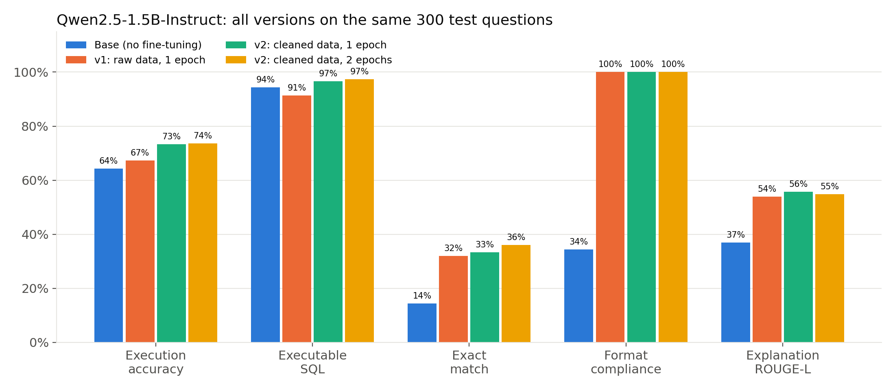
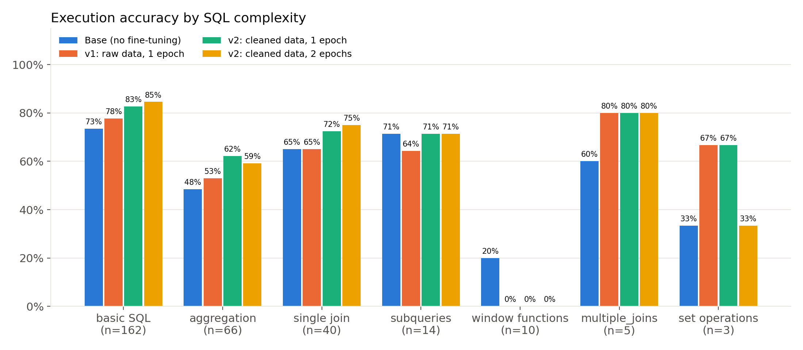
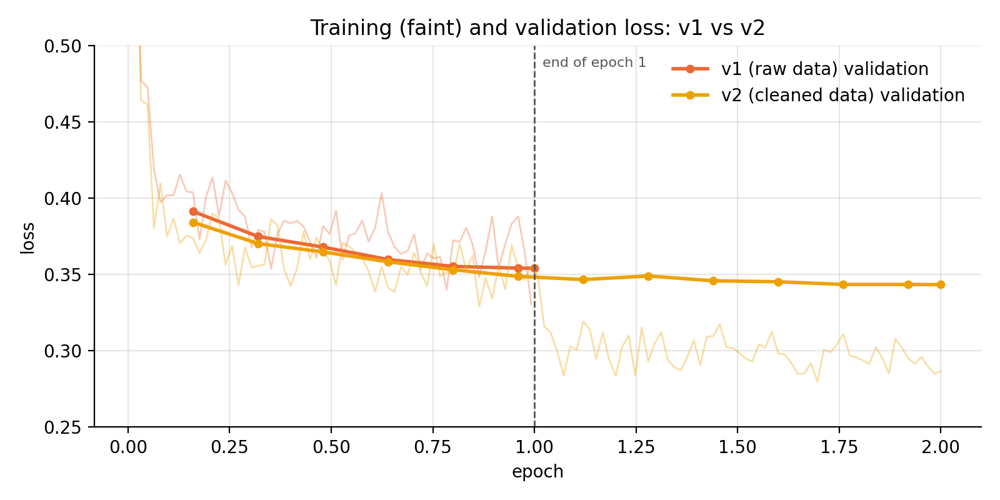
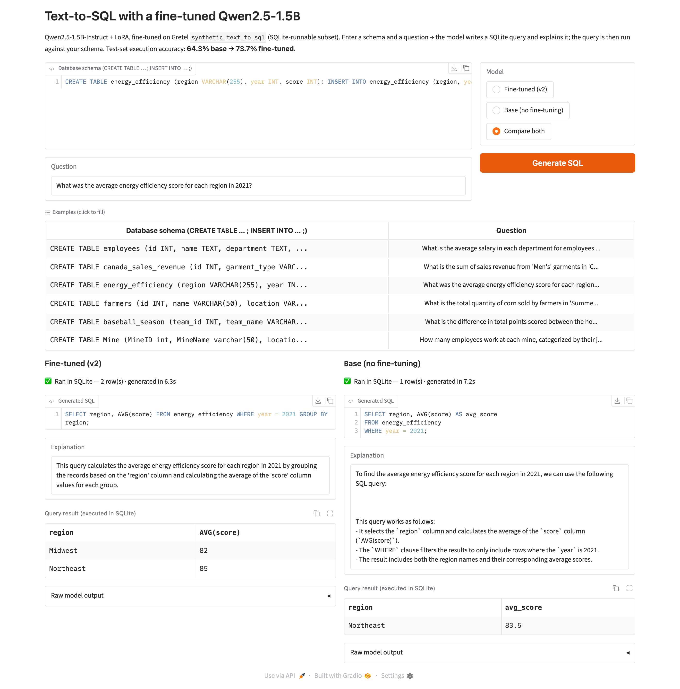

# Fine-tuning an LLM for Text-to-SQL with Gretel Synthetic Data — Project Report

CSYE 7380 Applied Generative AI · Model: Qwen2.5-1.5B-Instruct + LoRA · Data: `gretelai/synthetic_text_to_sql`

---

## 0. Summary

- **Task:** given a database schema and a natural-language question, the model outputs a **SQL query plus
  an explanation**.
- **Method:** **LoRA** fine-tuning of **Qwen2.5-1.5B-Instruct** (1.2% of parameters trained) on Gretel's
  synthetic text-to-SQL dataset, on a Google Colab L4 GPU.
- **Evaluation:** 300 test questions. The main metric is **execution accuracy**: the generated SQL is run
  in SQLite, and it counts as correct only if its result matches the gold query's result.
- **Two versions:**
  - **v1:** raw data, 1 epoch. Execution accuracy went from 64.3% to 67.3%, which is **not significant**
    (p = 0.27). Analysis showed that 23% of the training SQL was MySQL/Postgres dialect, so the model
    learned syntax that SQLite does not support.
  - **v2:** trained from scratch for 2 epochs on training data filtered to SQLite-runnable queries.
    It reaches **73.7%**: **+9.3 points over Base** (p = 0.0001) and **+6.3 points over v1** (p = 0.0003).
- **Key finding: data quality matters more than the number of epochs.** Cleaning the data gave
  +6.0 points. A second epoch gave only +0.3 (one more question) and doubled training time.
- **Interface:** a local Gradio web page. You can enter any schema and question, see the SQL, the
  explanation and the real execution result, and compare the base and fine-tuned models side by side.

| | Base (no fine-tuning) | v1 | **v2 (final)** |
|---|---|---|---|
| Execution accuracy | 64.3% | 67.3% | **73.7%** |
| Executable SQL | 94.3% | 91.3% | **97.3%** |
| Format compliance | 34.3% | 100% | **100%** |
| Explanation ROUGE-L | 0.37 | 0.54 | **0.55** |

---

## 1. Assignment requirements and what was delivered

| Requirement | Delivered | Where |
|---|---|---|
| Fine-tune an LLM on Gretel's synthetic text-to-SQL dataset | Qwen2.5-1.5B-Instruct + LoRA, two versions | notebooks in `v1/` and `v2/` |
| Generate SQL with an explanation from a schema and a question | The model always outputs ```` ```sql ... ``` ```` followed by `Explanation: ...` | Section 4 |
| Compare performance before and after fine-tuning | Base / v1 / v2 epoch 1 / v2 epoch 2 on the same 300 questions; 5 metrics plus significance tests | Sections 6–7, `comparison/` |
| Build a simple interface to query the fine-tuned model | Local Gradio app, `app.py` | Section 8 |
| About 3 slides | Outline in Appendix A | Appendix A |

---

## 2. Approach: how the project started

The project followed the order **data first, then model; get it working end to end, then analyze, then
improve**:

1. **Look at the data:** check which fields the dataset has and whether its SQL can be executed, and decide
   how to evaluate.
2. **Choose the model:** balance quality against whether a free GPU can train it. Chose
   Qwen2.5-1.5B-Instruct with LoRA.
3. **v1, a full first run:** raw data, 1 epoch, producing the first before/after comparison.
4. **Analyze v1's errors:** the gain was small. Going through the predictions question by question showed
   why: the training data contains a lot of dialect syntax that SQLite does not support.
5. **v2, a targeted fix:** clean the training data and train for 2 epochs, saving the model after each
   epoch. This **separates the effect of data cleaning from the effect of an extra epoch**.
6. **Full comparison and significance tests:** confirm that the gains are real and not chance.
7. **Build the interface** on the final v2 model.

---

## 3. Data

### 3.1 Dataset

`gretelai/synthetic_text_to_sql` is a text-to-SQL dataset that Gretel synthesized with LLMs. It has
100,000 training rows and 5,851 test rows across about 100 domains. Fields used in this project:

| Field | Content | Use |
|---|---|---|
| `sql_context` | `CREATE TABLE` + `INSERT INTO` statements | input: the schema, with sample data |
| `sql_prompt` | natural-language question | input: the question |
| `sql` | gold SQL query | training target |
| `sql_explanation` | natural-language explanation of the SQL | training target |
| `sql_complexity` | basic SQL / aggregation / single join / subqueries / window functions / … | stratified sampling, per-complexity evaluation |

**Key observation:** `sql_context` contains not only table definitions but also `INSERT` statements with
sample rows. So every question can be loaded into a real in-memory SQLite database and **its SQL can
actually be executed and the results compared**. This is why execution accuracy is the main metric.

### 3.2 Preprocessing (`prepare_data.py`)

| Step | What it does | Why |
|---|---|---|
| Cleaning | drop rows with empty fields and duplicate (question, schema) pairs | basic data quality |
| Length filter | drop schemas longer than 1,500 characters | shorter sequences train faster and more stably |
| Leakage removal | drop training rows whose (question, schema) pair appears in the test split | the model must not have seen the test questions |
| Stratified sampling | 10,000 train / 500 validation rows, stratified by `sql_complexity` | keeps the original complexity mix; 10k rows train in about 30 minutes on a Colab GPU |
| **Test set** | from the official test split, keep only **SELECT/WITH queries whose gold SQL executes in SQLite and returns rows** (3,427 qualify), then sample 300, stratified | every question can be scored by execution accuracy |
| Formatting | convert to system / user / assistant chat messages | works with any chat model's template |
| **v2 only:** `--sqlite-only` | keep only train/validation rows whose gold SQL executes in SQLite (76,302 of 99,995 kept, 23.7% removed) | see Section 6.2 |

- **The test set is identical for every version** (`data/test.jsonl`, fixed seed 42), so Base, v1 and v2
  can be compared directly.
- Test-set complexity mix: basic SQL 162, aggregation 66, single join 40, subqueries 14, window functions 10,
  multiple joins 5, set operations 3.

### 3.3 Input and output format

```
[system]    You are an expert SQL assistant. Given a database schema and a question, write a correct
            SQLite query that answers the question, then briefly explain what the query does.
[user]      ### Database schema:
            CREATE TABLE ...; INSERT INTO ...;
            ### Question:
            What is the total revenue ...?
[assistant] ```sql
            SELECT ...;
            ```

            Explanation: This query calculates ...
```

A fixed output format makes it easy to extract the SQL and explanation automatically, and teaching that
format is one of the goals of fine-tuning.

---

## 4. Model and training

### 4.1 Why Qwen2.5-1.5B-Instruct

| Consideration | Reason |
|---|---|
| Capability | Strong code and SQL ability for its size; the base model already answers 64% correctly without fine-tuning |
| Resources | With LoRA, 10k examples train in about 30 minutes on a Colab L4 (24 GB). The fine-tuned model also runs locally on a 16 GB Mac |
| Instruct version | It already follows chat instructions, so fine-tuning only has to teach SQLite syntax, the fixed format and concise explanations |
| Open weights | Downloaded from Hugging Face, **no API needed** |

### 4.2 Why LoRA

LoRA freezes all of the original model's weights and trains a pair of small low-rank matrices next to each
attention and MLP projection:

- trainable parameters: **18.5M of 1,562M = 1.18%**;
- low memory use and fast training; the saved adapter is only 74 MB;
- the same base model can switch between "before" and "after" fine-tuning by turning the adapter off or on.
  The interface's Compare mode works this way.

### 4.3 Training settings

| Setting | Value |
|---|---|
| LoRA | r = 16, alpha = 32, dropout = 0.05; applied to the q/k/v/o/gate/up/down projections |
| Learning rate | 2e-4, cosine decay, warmup over the first 3% of steps |
| Batch | 8 per step × gradient accumulation 2 = effective batch 16 |
| Epochs | v1: 1 epoch (625 steps); v2: 2 epochs (1,250 steps) |
| Precision | bf16 mixed precision + gradient checkpointing |
| Max length | 1,024 tokens (actual mean about 245, max 699; nothing truncated) |
| **Loss on the answer only** | prompt tokens get label -100, so the model learns how to answer instead of spending capacity on repeating the schema |
| Validation | loss on the 500-row validation set every 100 steps |
| Hardware / libraries | Google Colab NVIDIA L4; PyTorch + Hugging Face Transformers + PEFT |

### 4.4 Inference settings

Greedy decoding (`do_sample=False`, reproducible), at most 320 new tokens, batch 16 with left padding.
A regex extracts the SQL from the ```` ```sql ``` ```` block and the explanation after `Explanation:`.
If the model ignores the format, which the base model often does, the first SELECT statement is extracted
instead, so the base model is scored as fairly as possible.

---

## 5. Evaluation

| Metric | Definition | Notes |
|---|---|---|
| **Execution accuracy** (main) | run the predicted and gold SQL in SQLite; correct if the result sets match (row order ignored, floats compared to 4 decimals) | a different query that returns the right result still counts, so it is the closest measure of "is the SQL correct" |
| Executable SQL | share of predicted queries that run in SQLite without an error | measures syntax and dialect errors |
| Exact match | predicted SQL equals the gold SQL after normalizing whitespace and case | very strict; for reference only |
| Format compliance | output contains both a ```` ```sql ```` block and `Explanation:` | did the model learn the output format |
| Explanation ROUGE-L | ROUGE-L F1 between the predicted and gold explanations | explanation quality |

An **exact McNemar test** checks whether the difference between two models is significant. It uses only
the number of questions where A is wrong and B is right, and vice versa; p < 0.05 means the difference is
unlikely to be chance.

---

## 6. Training and results

### 6.1 v1: raw data, 1 epoch

- 625 steps in 32 minutes. Validation loss fell from 0.391 to 0.354 and leveled off after about 500 steps.
- Results:

| | Base | v1 | Change |
|---|---|---|---|
| Execution accuracy | 64.3% | 67.3% | +3.0 |
| Executable SQL | 94.3% | **91.3%** | **−3.0** |
| Exact match | 14.3% | 32.0% | +17.7 |
| Format compliance | 34.3% | 100% | +65.7 |
| Explanation ROUGE-L | 0.369 | 0.539 | +0.17 |

Format and explanation quality improved sharply: the model learned the "SQL first, then a one-sentence
explanation" style, and average output length fell from 615 to about 360 characters. But **execution
accuracy, the metric that matters most, rose only 3 points**. Question by question, v1 fixed 31 and broke
22 (McNemar p = 0.27, **not significant**). And **the share of executable SQL actually dropped**.

### 6.2 What went wrong in v1

Looking at the SQL v1 wrote that failed to run, many queries used **MySQL/Postgres functions that SQLite
does not support**:

```sql
-- Question: total donation amount by each program in Q1 2022
-- v1 (error: SQLite has no YEAR() / QUARTER())
... WHERE YEAR(d.donation_date) = 2022 AND QUARTER(d.donation_date) = 1 ...
-- gold
... WHERE d.donation_date BETWEEN '2022-01-01' AND '2022-03-31' ...
```

The cause is the training data. Gretel's data is LLM-generated with no fixed SQL dialect. Running every
gold query of the training set in SQLite showed that **2,307 of v1's 10,000 training examples (23%) fail**,
mostly because of `YEAR()`, `EXTRACT()`, `DATE_SUB()`, `INTERVAL` and similar. The model faithfully learned
these patterns and then failed on SQLite: 11 of v1's predictions use dialect functions, versus 2 for Base.

**Conclusion:** the problem was not the model or the training method. It was a **mismatch between the
training data and the target environment (SQLite)**.

### 6.3 v2: cleaned data, 2 epochs

Two changes, with everything else identical to v1 (model, LoRA, learning rate, batch, test set,
evaluation code):

1. **Data cleaning:** `prepare_data.py --sqlite-only` keeps only rows whose gold SQL executes in SQLite,
   and re-samples 10,000 / 500 rows. All 10,000 cleaned training queries run in SQLite.
2. **Two epochs**, with the adapter **saved and evaluated after each epoch**, to answer whether the gain
   comes from the data or from more training.

v2 is a **new LoRA trained from the original Qwen model**, not a continuation of v1. Its loss at step 10
was 0.665, similar to v1's starting loss. Training took 61 minutes for 1,250 steps.

### 6.4 Overall results, all versions



| | Execution accuracy | Executable SQL | Exact match | Format compliance | Explanation ROUGE-L |
|---|---|---|---|---|---|
| Base (no fine-tuning) | 64.3% | 94.3% | 14.3% | 34.3% | 0.369 |
| v1: raw data, 1 epoch | 67.3% | 91.3% | 32.0% | 100% | 0.539 |
| v2: cleaned data, 1 epoch | 73.3% | 96.7% | 33.3% | 100% | 0.557 |
| **v2: cleaned data, 2 epochs** | **73.7%** | **97.3%** | **36.0%** | 100% | 0.548 |

### 6.5 Gain from each step

| Step | Exec. accuracy change | Fixed / broken | McNemar p | Significant |
|---|---|---|---|---|
| Fine-tuning on raw data (Base → v1) | +3.0 | 31 / 22 | 0.27 | no |
| **Data cleaning (v1 → v2 epoch 1)** | **+6.0** | 23 / 5 | **0.0009** | **yes** |
| Extra epoch (v2 epoch 1 → epoch 2) | +0.3 | 4 / 3 | 1.00 | no |
| **Overall (Base → v2)** | **+9.3** | 40 / 12 | **0.0001** | **yes** |
| v1 → v2 | +6.3 | 23 / 4 | 0.0003 | yes |

### 6.6 Error breakdown

| | Wrong answers | Non-executable SQL | Uses MySQL/Postgres dialect |
|---|---|---|---|
| Base | 107 | 17 | 2 |
| v1 | 98 | 26 | 11 |
| v2 epoch 1 | 80 | 10 | 0 |
| **v2 epoch 2** | **79** | **8** | **0** |

### 6.7 By SQL complexity



| Complexity (test questions) | Base | v1 | v2 epoch 1 | v2 epoch 2 |
|---|---|---|---|---|
| basic SQL (162) | 73.5% | 77.8% | 82.7% | **84.6%** |
| aggregation (66) | 48.5% | 53.0% | **62.1%** | 59.1% |
| single join (40) | 65.0% | 65.0% | 72.5% | **75.0%** |
| subqueries (14) | 71.4% | 64.3% | 71.4% | 71.4% |
| window functions (10) | 20.0% | 0.0% | 0.0% | 0.0% |
| multiple joins (5) | 60.0% | 80.0% | 80.0% | 80.0% |
| set operations (3) | 33.3% | 66.7% | 66.7% | 33.3% |

In the four largest categories, v2 beats v1 by 6–10 points. In categories with fewer than 15 questions,
one question moves the score by 7–33 points, so they show trends only. Window functions are a clear
weakness (see Section 9).

### 6.8 Loss curves



- After v2's first epoch, **training loss keeps falling (0.355 → 0.287) while validation loss barely moves
  (0.349 → 0.343)**. The second epoch starts to memorize the training set and adds little generalization,
  which matches the +0.3-point gain on the test set.
- v1 and v2 use validation sets drawn from their own training data, so compare the shapes of the two
  validation curves, not their absolute values.

### 6.9 Examples

**Before vs after (Base → v2):** the base model often writes long explanations, uses MySQL-style escaping,
or forgets `GROUP BY`.

```sql
-- Question: What was the average energy efficiency score for each region in 2021?
-- Base (runs, but wrong: no GROUP BY, returns 1 row)
SELECT region, AVG(score) AS avg_score FROM energy_efficiency WHERE year = 2021;
-- v2 (correct: returns both regions)
SELECT region, AVG(score) FROM energy_efficiency WHERE year = 2021 GROUP BY region;

-- Question: What is the sum of sales revenue from 'Men's' garments in 'Canada'?
-- Base (error: SQLite does not accept \' escaping)
SELECT SUM(revenue) AS Total_Revenue FROM canada_sales_revenue WHERE garment_type = 'Men\'s';
-- v2 (correct: SQLite '' escaping)
SELECT SUM(revenue) FROM canada_sales_revenue WHERE garment_type = 'Men''s';
```

**v1 → v2:** v1's dialect errors are fixed.

```sql
-- Question: Obtain the total number of policies issued in 'Q2 2021'
-- v1 (error)
SELECT COUNT(*) FROM policies WHERE EXTRACT(QUARTER FROM issue_date) = 2 AND EXTRACT(YEAR FROM issue_date) = 2021;
-- v2 (correct)
SELECT COUNT(*) FROM policies WHERE issue_date BETWEEN '2021-04-01' AND '2021-06-30';
```

More examples, including the 4 questions v2 got wrong that v1 got right, are in `comparison/comparison.md`
and `v2/results/examples.md`.

---

## 7. v1 vs v2: differences and improvement

| | v1 | v2 |
|---|---|---|
| Training data | raw Gretel data (23% of its SQL fails in SQLite) | SQLite-runnable rows only (100% executable) |
| Epochs / steps | 1 / 625 | 2 / 1,250 (saved and evaluated after each epoch) |
| Training time (L4) | 32 min | 61 min |
| Everything else | identical: model, LoRA, learning rate, batch, test set, evaluation code | identical |
| Execution accuracy | 67.3% | **73.7% (+6.3)** |
| Executable SQL | 91.3% | **97.3% (+6.0)** |
| Exact match | 32.0% | **36.0% (+4.0)** |
| Dialect errors | 11 | **0** |
| Wrong answers | 98 | **79** |
| Significant vs Base? | no (p = 0.27) | **yes (p = 0.0001)** |

**Where the improvement comes from:** v1 → v2 epoch 1 (both trained for one epoch, only the data changed)
already gives +6.0 points; the second epoch adds just +0.3. So **almost all of the gain comes from data
cleaning**. Practical lessons:

1. Before fine-tuning, check that the training data matches the target environment (here, the SQL
   dialect). That is more effective than tuning hyperparameters or adding epochs.
2. Only an execution-based metric revealed the problem. v1's exact match rose from 14% to 32%, which looked
   good, while execution accuracy showed the real issue.
3. One epoch is enough. If only one version could be deployed, v2 epoch 1 gives the best cost/benefit;
   epoch 2 is slightly better and is the one used in the interface.

---

## 8. Query interface (Gradio)

`app.py` is a local web app. It runs on the Apple GPU of a 16 GB M2 Mac at 5–10 seconds per question.

- Enter a database schema (`CREATE TABLE` plus optional `INSERT`) and a question.
- Choose a model: **Fine-tuned (v2) / Base / Compare both**.
- The app shows the generated SQL, the explanation, and **the table that the SQL actually returns in
  SQLite** (or the error message).
- Six built-in examples (one hand-written, plus five test questions the base model gets wrong and the
  fine-tuned model gets right) fill the inputs with one click.

Compare mode uses a single model instance: the same base weights with the LoRA adapter turned on give the
fine-tuned model, and with it turned off give the base model. No second copy of the model is loaded.



*Screenshot: for the same question, the fine-tuned model (left) groups by region and returns 2 correct
rows; the base model (right) forgets `GROUP BY` and returns 1 row.*

To run it:

```bash
.venv/bin/python app.py      # opens http://127.0.0.1:7860 in the browser
```

---

## 9. Limitations and future work

| Limitation | Details | Possible improvement |
|---|---|---|
| Window functions 0/10 | only about 3% of training rows use window functions, and cleaning removed some of them; a 1.5B model struggles with complex queries | oversample complex queries; use a bigger model (3B/7B) |
| Strict metric | execution accuracy requires exactly the same columns, so `SELECT *` or a different column order counts as wrong even when the rows are right. 4 of the 12 questions v2 broke relative to Base are like this (3 `SELECT *`, 1 column order) | add a relaxed metric that ignores column order and allows extra columns |
| Small test set | 300 questions; percentages for small categories (<15 questions) swing a lot | larger test set, or report confidence intervals |
| Synthetic data | Gretel's data is LLM-generated with simple schemas (usually 1–3 small tables), unlike real business databases | evaluate on real benchmarks such as Spider or BIRD |
| Local vs Colab outputs differ slightly | greedy decoding occasionally takes a different path on different hardware; 18 of the first 20 test outputs were identical | expected; reported metrics come from the Colab runs |

---

## 10. Engineering issues and fixes

| Problem | Cause | Fix |
|---|---|---|
| `torchao` import error on Colab | Colab's preinstalled torchao conflicts with the new peft | `pip uninstall -y torchao` before installing |
| `TrainingArguments` rejected `warmup_ratio` | Colab ships transformers v5, which removed the argument | use an explicit `warmup_steps`; the code works on both v4 and v5 |
| v2's first run crashed at step 64 with `Errno 107 Transport endpoint is not connected` | training read and wrote Google Drive directly, and the Drive connection dropped | train on the Colab VM's local disk and use Drive only for backups (auto-reconnect on failure, never interrupts training); resume from the Drive checkpoint |
| Local loading of the adapter's tokenizer failed | the adapter was saved with transformers v5; the local environment has 4.57 | load the tokenizer from the base model (LoRA does not change the tokenizer) |

---

## 11. Project structure and reproduction

```
text-to-sql-finetuning/
├── prepare_data.py              # data prep (v1: raw; --sqlite-only: v2)
├── data/test.jsonl              # shared 300-question test set
├── data/v1/, data/v2/           # per-version train/val (stats.json records distributions)
├── v1/finetune_text2sql_v1.ipynb    v1/results/   # v1 training + evaluation (Colab)
├── v2/finetune_text2sql_v2.ipynb    v2/results/   # v2 training + evaluation (Colab)
├── compare_versions.py          # full comparison → comparison/
├── comparison/                  # comparison report, metrics, v1 vs v2 loss chart
├── app.py                       # Gradio query interface
└── REPORT.md                    # this report
```

1. Data: `python prepare_data.py` (v1) and `python prepare_data.py --sqlite-only` (v2). The seed is fixed,
   so the results are reproducible.
2. Training and evaluation: put the project in Google Drive, open the notebook in Colab (L4 GPU), and run
   all cells.
3. Comparison: `python compare_versions.py`.
4. Interface: `.venv/bin/python app.py`.

---

## Appendix A: outline for 3 slides

**Slide 1 — Approach**
- Task: schema + question → SQLite query + explanation
- Data: Gretel synthetic_text_to_sql; 10k training rows (stratified by complexity); 300 test questions
  whose gold SQL runs in SQLite
- Model: Qwen2.5-1.5B-Instruct + LoRA (r = 16, 1.2% of parameters), Colab L4, loss on the answer only
- Metric: **execution accuracy** (run both queries in SQLite and compare results)

**Slide 2 — Results: before vs after**
- Chart: `v2/results/all_versions_metrics.png`
- Base 64.3% → **v2 73.7%** (+9.3 pts, p = 0.0001); format 34% → 100%; ROUGE-L 0.37 → 0.55
- Key finding: v1 gained only +3 (not significant) because 23% of the training SQL was MySQL/Postgres
  dialect. Cleaned data (v2) gave +6 pts; an extra epoch gave +0.3
- **Data quality > more epochs**

**Slide 3 — Demo and takeaways**
- Screenshot: `report_assets/ui_compare.png` (or a live demo of Compare mode)
- Weaknesses: window functions (0/10), strict metric, small synthetic schemas
- Next steps: oversample complex queries, try a bigger model, evaluate on Spider/BIRD
